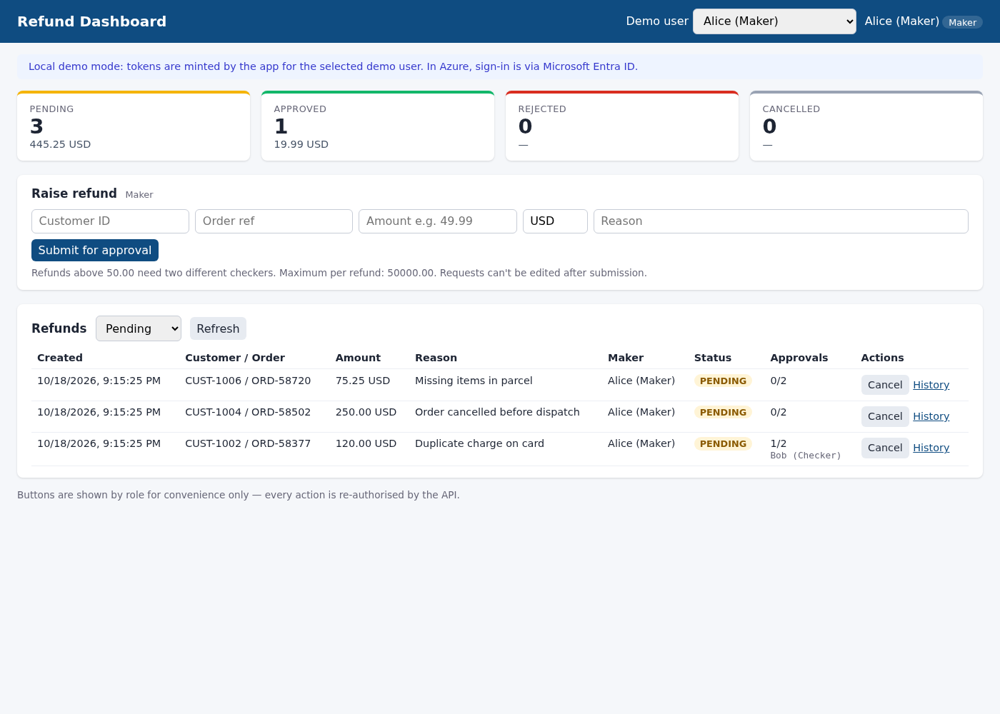
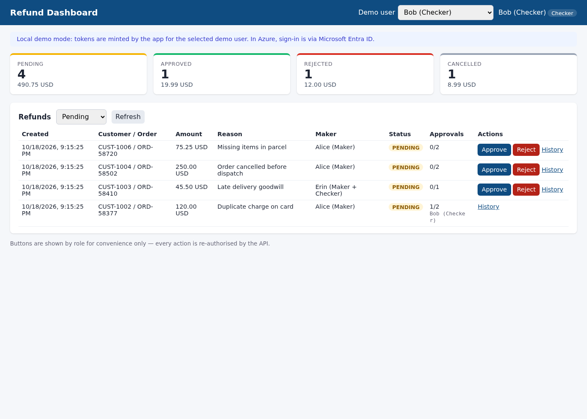
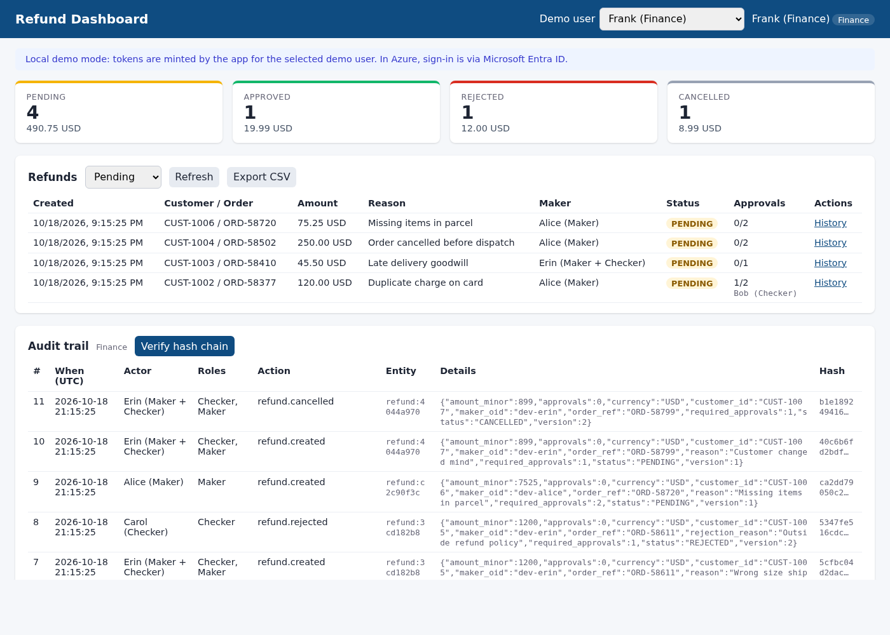
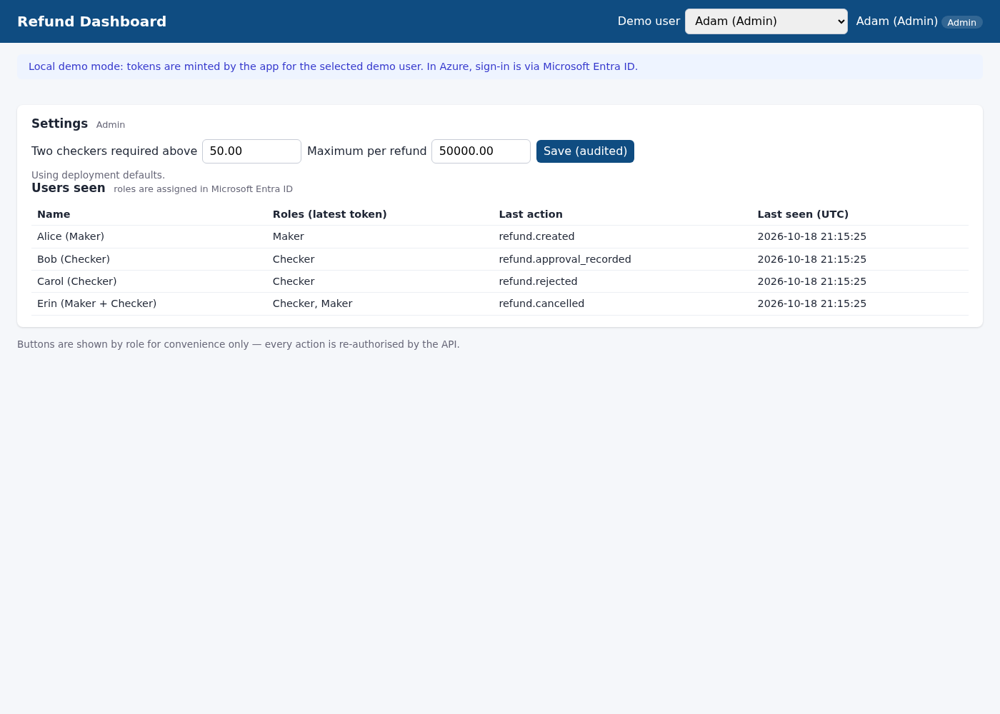

# Refund Dashboard

A standalone refund-approval app that replaces a Power Apps workflow. One container serves a
Python (FastAPI) API and a web dashboard. It enforces maker-checker segregation of duties and
role-based access on the server, and writes an immutable, tamper-evident audit trail. It ships
with Azure infrastructure-as-code for customers to deploy themselves, plus a local demo that
needs no Azure or Entra tenant.

| Maker | Checker | Finance | Admin |
|---|---|---|---|
|  |  |  |  |

## Run the demo locally

```bash
docker compose up --build
# open http://localhost:8000  (pick a demo user top-right, or use ?as=frank)
```

The demo uses SQLite with a few sample refunds. Tokens are minted locally for these demo users:

| User | Roles | Try |
|---|---|---|
| alice | Maker | Raise a $75 refund. It needs 2 approvals. |
| bob, carol | Checker | Approve it as bob, then carol. Bob can't approve twice. |
| erin | Maker + Checker | Raise a refund, then try to approve it. Blocked and audited. |
| frank | Finance | Summary, all refunds, CSV export, audit trail, **Verify hash chain**. |
| adam | Admin | Change the threshold. The change is audited, and adam can't see or act on refunds. |

Without Docker: `pip install -r requirements-dev.txt && REFUND_SEED_DEMO_DATA=true uvicorn --factory app.main:create_app`.

## Controls

**Roles.** Roles are Entra ID app roles, and the API checks them on every request:

| Role | Can | Can't |
|---|---|---|
| `Refund.Maker` | Raise refunds, cancel own pending ones, see own refunds | Approve anything |
| `Refund.Checker` | See all refunds, approve or reject other people's | Decide a refund they raised |
| `Refund.Finance` | Read-only: all refunds, summary, CSV export, audit trail, chain verification | Raise, approve or reject |
| `Refund.Admin` | Change the dual-approval threshold and max amount, see users and roles in use | Raise, approve or view refunds |

Finance and Auditor are merged into one role. If internal audit must stay independent of
Finance, add `Refund.Auditor` back in `app/auth.py` and `infra/entra/app-roles.json`.

**Maker-checker:**
- Refunds can't be edited after submission.
- A checker can never decide a refund they raised. The check uses the immutable Entra object
  ID (`oid`), so holding both roles doesn't help.
- Refunds **strictly above $50** need two *different* checkers.
- Each checker may approve a given refund only once.
- An Admin who also holds Maker or Checker can't change limits.

**Integrity:**
- Optimistic concurrency (`expected_version`, row version) stops double decisions.
- An `Idempotency-Key` header stops duplicate submissions.
- Amounts are stored in minor units.
- There's a configurable maximum per refund.

**Immutable audit:**
- Every change, and every denied segregation-of-duties attempt, writes an audit event in the
  same transaction.
- Each event records the actor, the roles they held, and before/after values.
- Events are SHA-256 hash-chained, and `GET /api/audit/verify` recomputes the chain.
- In Azure the table is an Azure SQL **append-only ledger table**. The engine rejects
  UPDATE/DELETE, even for admins.
- Database digests are uploaded automatically to **WORM blob storage**, so tampering by a
  DBA can be detected (`infra/sql/verify_ledger.sql`).
- Locally, SQLite triggers stand in for this.

**Authentication.** In Azure, the dashboard signs users in with MSAL.js (Entra ID, auth code +
PKCE). The API accepts only RS256 Entra v2 access tokens and checks:
- tenant JWKS signature
- `iss`, `aud` and `tid`
- expiry
- required claims

Local demo tokens are disabled when `REFUND_ENVIRONMENT=production`.

## API

| Method & path | Roles |
|---|---|
| `GET /api/me` | any signed-in user |
| `POST /api/refunds` (header `Idempotency-Key`) | Maker |
| `GET /api/refunds?status=`, `GET /api/refunds/{id}`, `GET /api/refunds/{id}/history`, `GET /api/refunds/summary`, `GET /api/refunds/limits` | Maker (own), Checker, Finance |
| `POST /api/refunds/{id}/approve` · `/reject` | Checker (not the maker) |
| `POST /api/refunds/{id}/cancel` | Maker (own, pending) |
| `GET /api/refunds/export.csv` | Finance |
| `GET /api/audit/events`, `GET /api/audit/verify` | Finance |
| `GET/PUT /api/admin/settings`, `GET /api/admin/users`, `GET /api/admin/roles` | Admin |

OpenAPI docs are at `/docs`.

## Tests

```bash
pip install -r requirements-dev.txt
ruff check . && ruff format --check . && pytest
```

The tests cover:
- token forgery: `alg=none`, HS256, wrong key/issuer/audience, missing claims
- the full role matrix
- self-approval and dual-role users
- the $50.00 vs $50.01 boundary and distinct second checkers
- idempotency
- concurrent approvals
- admin limits and auditing
- CSV formula-injection safety
- hash-chain tamper detection and append-only enforcement

CI also compiles the Bicep and builds and smoke-tests the container.

## Deploy to Azure (customer-run)

Nothing is deployed by this repo. The templates create:

```
Entra ID (sign-in, app roles) ──> Container Apps (API + UI, managed identity) ──> Azure SQL ledger DB
                                       │  pulls image from Azure Container Registry     │ digests
                                       └─ logs ─> Log Analytics          WORM Blob Storage <┘
```

1. `infra/entra/setup-app-registration.sh`: creates the app registration with the four app
   roles, the `Refunds.Access` scope and the SPA redirect URI.
2. `RG=... LOCATION=... ENTRA_CLIENT_ID=... SQL_ADMIN_GROUP_ID=... SQL_ADMIN_GROUP_NAME=... infra/deploy.sh`:
   deploys the infrastructure, builds the image in ACR with `az acr build`, then deploys the
   Container App.
3. Run `infra/sql/001_schema.sql`, then `002_app_user.sql` (grants with no DELETE), add the app URL
   as a redirect URI, and assign users or groups to roles.
4. Lock the WORM policy once verified. Locking is irreversible.

The parameters are in `infra/main.bicepparam`, e.g. `minReplicas`, SQL SKU and threshold.
For production, add VNet integration and private endpoints, and disable public SQL access.

## Cost

Roughly **$10/month** for a demo or pilot and **~$44/month** for a recommended production setup
(East US list prices). See [docs/pricing.md](docs/pricing.md) for the assumptions, or
`python scripts/azure_pricing.py --region <region>` to recalculate.

## Out of scope

- Paying out refunds or integrating with payment or ERP systems.
- Per-currency limits. There's one threshold, applied to the amount in any currency.
- Notifications, e.g. Teams or email to checkers.
